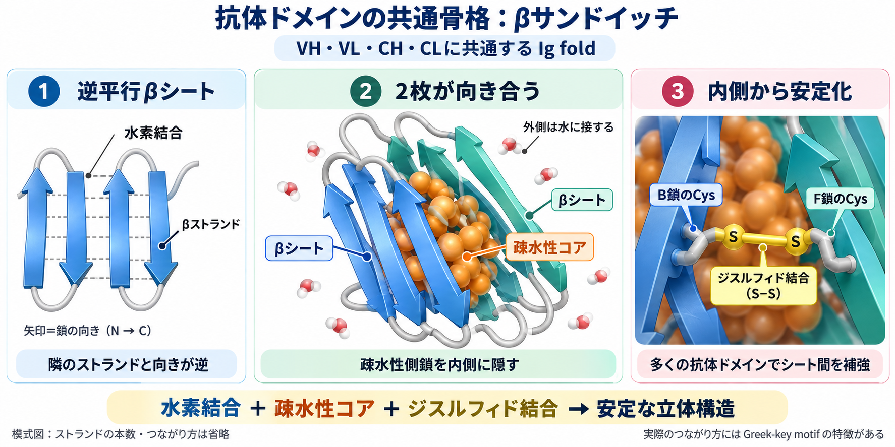
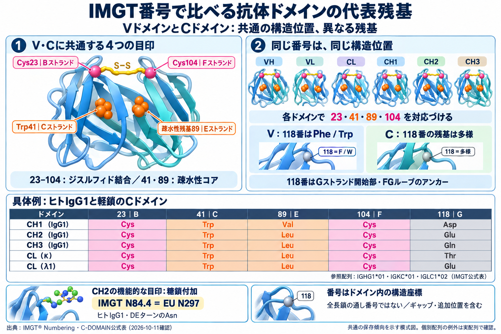
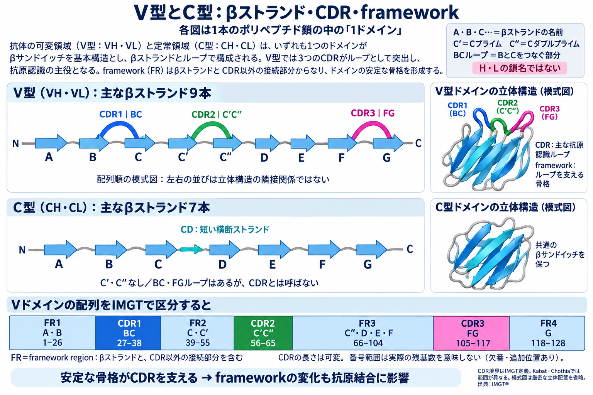

# Day 016：免疫グロブリンドメインの構造原理

## 今日の問い

VH、VL、CH、CLは配列も役割も異なるのに、なぜ共通の「免疫グロブリンフォールド」を保てるのか。また、その共通骨格は抗原認識と抗体工学をどう支えるのだろうか。

## 本文

### 1. ドメインは抗体を組み立てる構造単位である

**ドメイン**とは、ポリペプチド鎖の中で一まとまりの立体構造をつくる単位である。抗体では各ドメインがおよそ110残基前後で、似た形を繰り返す。IgG軽鎖はN末端側のVLとC末端側のCL、重鎖はVH、CH1、CH2、CH3からなり、分子全体では12個のドメインをもつ。VHはheavy-chain variable domain、VLはlight-chain variable domain、CHとCLはそれぞれ重鎖・軽鎖のconstant domainを指す。[IMGTの定義](https://www.imgt.org/IMGTindex/Domain.php)

ここで「可変」「定常」は主として**個体内の抗体配列を比べたときの多様性**を表し、「柔らかい領域」「機能をもたない領域」という意味ではない。可変ドメインにも保存された構造骨格があり、定常ドメインにもアイソタイプやサブクラスによる配列差がある。Day 15のY字形を部品へ分解するだけでなく、各部品がどう折りたたまれ、どの部品と対をつくるかを見るのが今日の焦点である。

### 2. 共通骨格は逆平行βシートのサンドイッチである



**図の読み方：** ① 矢印はβストランドのN末端からC末端への向き。隣同士が逆向きに並び、水素結合でβシートをつくる。② 2枚のシートが向き合い、内側に疎水性側鎖を隠す。③ 多くの抗体ドメインでは、B・Fストランド上のCysがS–S結合をつくり、シート間を補強する。図中の「B鎖」「F鎖」はβストランドB・Fを指し、抗体の重鎖・軽鎖とは異なる。ストランドの本数と正確なつながり方は省略した模式図である。

VH、VL、CH、CLはいずれも、複数の**逆平行βストランド**が二枚のβシートをつくり、互いに向き合うβサンドイッチ構造をとる。ストランドのつながり方にはGreek-key motifと呼ばれる特徴があり、この立体構造を**免疫グロブリンフォールド（Ig fold）** という。二枚のシートの内側には疎水性側鎖が集まり、水から隠れたコアをつくる。配列がかなり違っても、コアを支える残基配置とストランド間の水素結合網が保たれれば、共通の折りたたみを維持できる。[Feige et al., 2010](https://doi.org/10.1016/j.tibs.2009.11.005)

多くの抗体ドメインではBストランドとFストランドの保存システイン間に**ドメイン内ジスルフィド結合**ができ、二枚のシートを横断して安定化する。保存トリプトファンなどの疎水性残基もコア形成に寄与する。ただしジスルフィド結合だけが形を決めるのではない。周囲の疎水性充填、水素結合、ループの長さが協調して初めて正しいfoldになる。「システインが2個あるからIgドメイン」と配列だけで断定せず、位置関係とドメイン全体の相同性を見る必要がある。IMGT番号ではVドメインの代表的な保存位置をCys23、Trp41、疎水性残基89、Cys104として対応づけられる。[IMGT unique numbering](https://www.imgt.org/IMGTindex/numbering.php)

#### IMGT番号でV・Cドメインの代表残基を比較する



**共通の目印はVドメインだけのものではない。** CドメインであるCH・CLでも、BストランドのCys23、CストランドのTrp41、Eストランドの疎水性残基89、FストランドのCys104が代表的な保存位置になる。Cys23–Cys104はドメイン内S–S結合、Trp41と89番の側鎖は疎水性コアを支える。同じ番号は構造上対応する位置を示し、残基が全ドメインで完全に同じという意味ではない。[IMGT Numbering](https://www.imgt.org/IMGTindex/numbering.php)

次の表は**ヒトIGHG1*01・IGKC*01・IGLC1*02という具体的な参照配列** の値である。すべての種・アイソタイプ・アロタイプ・変異体へ、そのまま当てはめる表ではない。[IMGT公式Cドメイン残基表](https://www.imgt.org/IMGTbiotechnology/IGHG1_IGKC_IGLC_C_and_K.html)

| ドメイン（参照配列） | 23：Bストランド | 41：Cストランド | 89：Eストランド | 104：Fストランド | 118：Gストランド開始部 |
|---|---|---|---|---|---|
| CH1（ヒトIgG1） | Cys（C） | Trp（W） | Val（V） | Cys（C） | Asp（D） |
| CH2（ヒトIgG1） | Cys（C） | Trp（W） | Leu（L） | Cys（C） | Glu（E） |
| CH3（ヒトIgG1） | Cys（C） | Trp（W） | Leu（L） | Cys（C） | Gln（Q） |
| CL（ヒトκ） | Cys（C） | Trp（W） | Leu（L） | Cys（C） | Thr（T） |
| CL（ヒトλ1） | Cys（C） | Trp（W） | Leu（L） | Cys（C） | Glu（E） |

**118番がV・Cの違いを示す。** VドメインではJ領域由来のPhe118またはTrp118が保存される。一方、Cドメインの118番は残基が多様で、FGループの末端側アンカーとして対応づけられる。89番も「疎水性という性質の保存」であり、必ずLeuという意味ではない。[IMGT公式表の保存位置の説明](https://www.imgt.org/IMGTbiotechnology/IGHG1_IGKC_IGLC_C_and_K.html)

**CH2には機能を示す目印もある。** ヒトIgG1のDEターンにあるAsn84.4はN結合型糖鎖の付加位置で、よく使われるEU番号のAsn297と同じ残基を指す。IMGTの「84.4」は84番付近の追加位置を表す番号で、小数値ではない。[IMGTの糖鎖位置](https://www.imgt.org/IMGTbiotechnology/IGHG1_IGKC_IGLC_C_and_K.html)、[IMGT–EU番号対応表](https://www.imgt.org/IMGTScientificChart/Numbering/Hu_IGHGnber.html)

**番号は各ドメイン内の構造座標。** 「CH1のCys23」と「CH3のCys23」は別の残基で、重鎖全長の23番目を指すわけではない。ギャップや追加位置を含むため、配列を先頭から数えるだけではIMGT番号にならない。C型の番号付けは抗体・T細胞受容体以外のIgスーパーファミリーのC-LIKE-DOMAINにも適用されるが、個々の残基の保存は対象配列で確認する。[IMGT C-DOMAIN／C-LIKE-DOMAINの番号付け](https://www.imgt.org/IMGTScientificChart/Numbering/IMGTIGVCsuperfamily.html)

調査範囲：Day 16で扱う抗体ドメインを中心に、ヒトIgG1のCH1・CH2・CH3とκ・λ1のCLを比較。公式資料確認日：2026-10-11。

### 3. V型とC型は同じ骨格の異なる設計である



**図の読み方：** A・B・C・C′・C″・D・E・F・Gは、1ドメイン内のβストランドの名前であり、重鎖H・軽鎖Lの名前ではない。C′は「Cプライム」、C″は「Cダブルプライム」と読む。図の横並びはN末端からC末端への**配列順**を示し、立体構造で隣り合う順序を示すものではない。BCループはBとC、C′C″ループはC′とC″、FGループはFとGをつなぐ部分で、VドメインではそれぞれCDR1・CDR2・CDR3に対応する。[IMGTのストランド・ループとFR／CDRの対応](https://www.imgt.org/IMGTeducation/Tutorials/3Dstructure/_UK/DOMAINs/fleches.html)

**frameworkはCDRを支える部分。** Vドメインの配列は、FR1 → CDR1 → FR2 → CDR2 → FR3 → CDR3 → FR4と区分される。FRはframework regionの略で、βストランドだけでなく、CDR以外の接続部分も含む。下の範囲はIMGT定義の構造番号であり、欠番や追加位置があるため、そのまま実際の残基数にはならない。Kabat・Chothia定義ではCDR境界が異なる。[IMGTのFR・CDR定義](https://www.imgt.org/IMGTScientificChart/Nomenclature/IMGT-FRCDRdefinition.html)

| Vドメインの領域 | 主なストランドまたはループ | IMGT位置 |
|---|---|---|
| FR1 | A・B | 1–26 |
| CDR1 | BCループ | 27–38 |
| FR2 | C・C′ | 39–55 |
| CDR2 | C′C″ループ | 56–65 |
| FR3 | C″・D・E・F | 66–104 |
| CDR3 | FGループ | 105–117（長い場合は追加位置あり） |
| FR4 | G | 118–128 |

**C型にもループはある。** 主なβストランドはA・B・C・D・E・F・Gの7本で、C′・C″を欠く一方、CとDの間に短い横断ストランドCDがある。「7本」は主要ストランドを数えた単純化である。C型のBC・FGループは、V型の抗原認識ループであるCDRとは呼ばない。[IMGT C-DOMAINの構造・番号付け](https://www.imgt.org/IMGTScientificChart/Numbering/IMGTIGVCsuperfamily.html)

可変ドメインと定常ドメインは同じIg foldを共有するが、単純化するとV型は9本、C型は7本のβストランドからなる。V型にはC′、C″と呼ばれる追加ストランドがあり、ストランドをつなぐBC、C′C″、FGループが3本のCDRに対応する。特にFGループであるCDR3は長さの変動が大きい。対してC型のループは一般に短く、抗原認識用の多様な突起をつくる設計ではない。つまり進化は、安定なβサンドイッチを壊さず、その端のループを変化させることで認識面を多様化したと考えられる。[Chiu et al., 2019](https://doi.org/10.3390/antib8040055)

この区別は「V型だけが重要」という意味ではない。C型ドメインは鎖同士の会合、FabとFcの形の維持、Fc受容体や補体との相互作用などを担う。さらに、βストランド本体とCDRを機械的に切り離せるわけでもない。CDRの付け根はframework上にあり、frameworkの置換がループの形や動きを変えて結合性へ影響する。

### 4. VHとVLは対になって一つの抗原結合面をつくる

VH単独とVL単独に「半分ずつの独立した結合部位」があるのではない。通常の抗体ではVHとVLが非共有結合で会合し、両ドメインの端にある計6本のCDRが集まって一つのパラトープを形成する。VH–VL界面の多くはframework残基でつくられ、その相対的な向きはCDRの空間配置、したがってパラトープの幅や形にも影響する。古典的構造解析では、VH–VL界面に埋もれる表面積の約4分の3がframework由来と報告された。[Chothia et al., 1985](https://doi.org/10.1016/0022-2836(85)90137-8)

この事実はヒト化やscFv設計で重要である。CDR配列を保存しても、frameworkを変えてVH–VLのpackingが変われば、親和性や特異性が変わりうる。逆に、VHとVLを柔軟なリンカーでつなぐscFvでも、各ドメインのfoldと両者の適切な会合を保てれば抗原結合能を維持できる。「CDRが同じだから同じbinder」とは限らず、ドメイン間の幾何を確認する必要がある。

### 5. 定常ドメインも相手を選んで組み上がる

FabではCH1がCLと対をつくり、その上にVH–VL対が載る。一方、Fcでは同じ重鎖同士のCH3が強く会合し、CH2は糖鎖をもち比較的可動性のある配置をとる。このように、同じIg foldの反復でも表面残基の違いが「どの相手と、どの向きで会合するか」を指定する。ドメインは独立した積み木に似るが、どの組合せでも交換可能な規格品ではない。

抗体の分泌には組立品質管理も働く。未会合のCH1は小胞体シャペロンBiPと結合し、CLとの会合を契機に折りたたみが進むため、不完全な重鎖の分泌を抑えるチェックポイントになる。この性質は、単離ドメインの安定性だけ測って完全抗体の生産性を推測する危険も示す。分子内での相手、酸化環境、発現宿主を含めて評価しなければならない。[Feige et al., 2010](https://doi.org/10.1016/j.tibs.2009.11.005)

### 6. 配列を読むときは「境界・位置・構造」を対応させる

論文やデータセットの抗体配列を見たら、まず全長配列か、VH/VLだけか、Fabかを確認する。次にドメイン境界、鎖種、残基番号付け法を見る。Kabat、Chothia、IMGTなどは挿入位置やCDR境界が異なるため、同じ「H52」でも方式が違えば別残基になりうる。構造に基づくIMGT番号付けは、長さの異なる配列でも保存残基を対応させる共通座標を提供するが、番号付け法を明記せずに変異位置やモデル特徴量を比較してはいけない。

Ig foldは抗体を頑丈なモジュールにする一方、変異の影響を局所だけに閉じ込める保証ではない。CDR変異が抗原接触を変え、framework変異がfoldやVH–VL角度を変え、定常ドメイン変異が会合やエフェクター機能を変える。抗体工学では、配列上の所属領域、ドメイン内の構造環境、ドメイン間相互作用という三段階で変異を読むことが重要である。

## 図または比較表

```text
軽鎖:  N末端 [ VL：V型Ig fold ]―[ CL：C型Ig fold ] C末端
                    ╲              ╲
                     VH–VL対        CH1–CL対   → Fab
                    ╱              ╱
重鎖:  N末端 [ VH：V型Ig fold ]―[ CH1 ]―hinge―[ CH2 ]―[ CH3 ] C末端
                                                    CH3–CH3対 → Fc二量体

          VHのCDR 3本 + VLのCDR 3本 → 1つのパラトープ
```

| 観点 | VH・VL（可変ドメイン） | CH・CL（定常ドメイン） |
|---|---|---|
| 共通骨格 | 逆平行βシート2枚のIg fold | 逆平行βシート2枚のIg fold |
| βストランド | 概ね9本、C′・C″を含む | 概ね7本 |
| 目立つループ | 3本のCDR、長さと配列が多様 | 一般に短く、CDRではない |
| 主な役割 | VH–VL対で抗原認識面を形成 | 鎖の会合、構造支持、エフェクター機能 |
| 工学上の注意 | CDRだけでなくframeworkとVH–VL角度も重要 | CH1–CL会合、Fc会合、糖鎖など文脈依存 |

## 論文を読むためのポイント

- `VH/VL sequence`と書かれていても、signal peptide、定常領域、タグ、リンカーが含まれるかをMethodsで確認する。
- 変異位置は番号だけでなく、鎖、ドメイン、CDR/framework、番号付け方式をセットで読む。
- 構造図では各ドメインのβサンドイッチ、ドメイン内ジスルフィド、VH–VL界面、欠損残基を区別する。
- 「安定化」の根拠が単離VH、scFv、Fab、intact IgGのどのformatで得られたかを確認する。
- CDR移植後の結合低下は、直接接触残基だけでなくframeworkによるループ支持やVH–VL配向の変化も候補にする。

## 抗体×AIとの接続

抗体配列モデルでは、ドメイン境界と番号付けが入力とラベルの対応を左右する。可変長CDRを単純な配列位置で揃えると、別の構造位置を同じ特徴列へ混ぜる危険があるため、IMGTなどの番号付けや構造アラインメントを明記する必要がある。また、VHとVLを別々に予測して後で結合するモデルは、鎖間interfaceと相対配向の情報を失いうる。ペア配列、CDRだけでなくframework、必要ならCH1–CLまで含める設計が目的に合うかを検討する。

学習・テスト分割でも、同じgermline由来でframeworkがほぼ同一の配列が両側に入ると、モデルがIg foldの一般則ではなく系列固有の近道を記憶する可能性がある。CDR配列一致だけでなく、VH/VL germline、clonotype、抗原、構造テンプレートの重複を監査する。

## 重要用語5〜8語

- **免疫グロブリンフォールド（Ig fold）**：二枚の逆平行βシートからなる、抗体ドメインに共通の立体構造。
- **βサンドイッチ**：二枚のβシートが向き合って疎水性コアを挟む構造。
- **VH**：重鎖N末端の可変ドメイン。VLと会合してパラトープをつくる。
- **VL**：軽鎖N末端の可変ドメイン。κ鎖またはλ鎖に属する。
- **CH**：重鎖の定常ドメイン群。IgGではCH1、CH2、CH3がある。
- **CL**：軽鎖の定常ドメイン。Fab内でCH1と会合する。
- **framework**：可変ドメインでCDRを支え、foldとVH–VL界面を形成する骨格領域。
- **ドメイン内ジスルフィド結合**：同一Igドメイン内の保存システイン間に形成され、βサンドイッチを安定化する共有結合。

## 理解確認問題2問と各問題の簡潔な模範回答

### 問1

可変ドメインは配列が多様なのに、なぜ共通のIg foldを保てるのか。

**模範回答：** 多様性は主に表面ループへ集中し、βストランド、水素結合網、疎水性コア、保存ジスルフィド結合を支える残基配置が比較的保たれるためである。配列の完全一致ではなく、構造を支える位置関係の保存が重要である。

### 問2

CDR配列が同じ二つの抗体で親和性が異なった場合、frameworkについて何を疑うべきか。

**模範回答：** frameworkの違いがCDRの形や柔軟性、またはVH–VLの相対配向を変えた可能性を疑う。CDR配列だけでなく、鎖間interfaceと抗体formatを同じ条件で比較する。

## さらに調べる疑問2〜3問

1. Kabat、Chothia、IMGTの番号付けではCDR境界が具体的にどう違うか。
2. CH1がCLと会合するまで完全にfoldしない性質は、Fabの発現収量へどう影響するか。
3. VHHはVLなしで安定に存在するため、通常のVH–VL界面に相当する表面をどう変えているか。

## 自分の3行要約

- VH、VL、CH、CLは、逆平行βシート2枚と保存ジスルフィド結合を基本とするIg foldを共有する。
- V型では安定なframeworkの端に多様なCDRが並び、VH–VLの会合によって一つの抗原結合面ができる。
- 抗体×AIでは、鎖・ドメイン・番号付けを統一し、ペア配列と系列重複を扱うことが重要である。

## 未解決の疑問

同じVH・VL配列でも環境によって複数の相対配向を取りうるとき、単一の予測構造はその分布と結合能をどこまで代表できるのだろうか。

## 参考文献

1. Feige MJ, Hendershot LM, Buchner J. [How antibodies fold](https://doi.org/10.1016/j.tibs.2009.11.005). *Trends Biochem Sci.* 2010;35:189–198.
2. Chiu ML, Goulet DR, Teplyakov A, Gilliland GL. [Antibody Structure and Function: The Basis for Engineering Therapeutics](https://doi.org/10.3390/antib8040055). *Antibodies (Basel).* 2019;8:55.
3. Chothia C, Novotný J, Bruccoleri R, Karplus M. [Domain association in immunoglobulin molecules: The packing of variable domains](https://doi.org/10.1016/0022-2836(85)90137-8). *J Mol Biol.* 1985;186:651–663.
4. Lefranc M-P, et al. [IMGT unique numbering for immunoglobulin and T cell receptor variable domains and Ig superfamily V-like domains](https://pubmed.ncbi.nlm.nih.gov/12477501/). *Dev Comp Immunol.* 2003;27:55–77. DOI: 10.1016/S0145-305X(02)00039-3.
5. Lefranc M-P, et al. [IMGT unique numbering for immunoglobulin and T cell receptor constant domains and Ig superfamily C-like domains](https://doi.org/10.1016/j.dci.2004.07.003). *Dev Comp Immunol.* 2005;29:185–203.
6. IMGT®. [DOMAIN](https://www.imgt.org/IMGTindex/Domain.php) / [Numbering](https://www.imgt.org/IMGTindex/numbering.php). Accessed 2026-09-05.
7. IMGT®. [Lysines and cysteines of the Homo sapiens IGHG1, IGKC and IGLC1 and positions in the C-DOMAIN](https://www.imgt.org/IMGTbiotechnology/IGHG1_IGKC_IGLC_C_and_K.html). Accessed 2026-10-11.
8. IMGT®. [IMGT unique numbering for C-DOMAIN and C-LIKE-DOMAIN](https://www.imgt.org/IMGTScientificChart/Numbering/IMGTIGVCsuperfamily.html). Accessed 2026-10-11.
9. IMGT®. [Correspondence between C numberings: Human IGHG](https://www.imgt.org/IMGTScientificChart/Numbering/Hu_IGHGnber.html). Accessed 2026-10-11.
10. IMGT®. [Strand representation of two associated V-DOMAINs](https://www.imgt.org/IMGTeducation/Tutorials/3Dstructure/_UK/DOMAINs/fleches.html). Accessed 2026-10-11.
11. IMGT®. [Definition of the FR-IMGT and CDR-IMGT regions](https://www.imgt.org/IMGTScientificChart/Nomenclature/IMGT-FRCDRdefinition.html). Accessed 2026-10-11.
